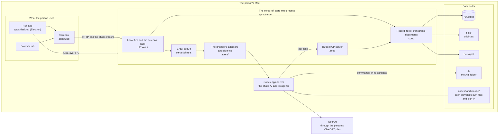
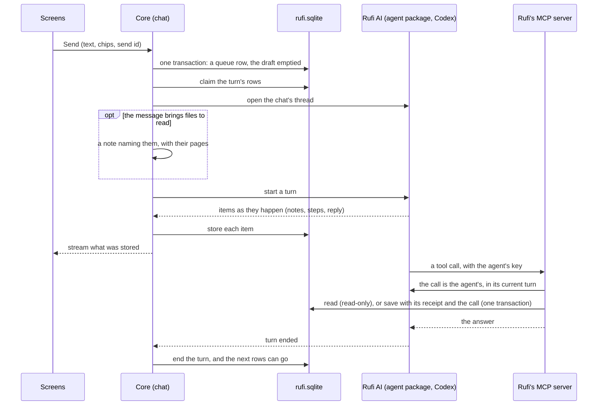

# How Rufi works

For developers: the main parts of Rufi, where its data lives and how it moves. It stays high level; the code and its tests have the detail, and the ADRs in [`adr/`](adr/) say why. The rules for working in the code are in [`AGENTS.md`](../AGENTS.md); what people see and do is in the [help](help/index.md).

## The parts

Everything runs on the person's Mac. One process, the core (`rufi start`), owns the data folder; the screens, the Rufi app and the AI reach the record only through it.

| Part                                    | What it does                                                                                                                                           | Borders                                                                                                                                   |
| --------------------------------------- | ------------------------------------------------------------------------------------------------------------------------------------------------------ | ----------------------------------------------------------------------------------------------------------------------------------------- |
| **Screens** (`apps/web`)                | React pages: the record, the chat, documents, Settings, Help.                                                                                          | Read the record only through GET routes; every change starts in the chat. Use only `@rufi/contracts`, `@rufi/brand` and the HTTP API.     |
| **Rufi app** (`apps/desktop`)           | An Electron window on the same screens, with notices on the Mac.                                                                                       | Runs `rufi start` as a child and talks to it over Node's IPC channel; imports no server or screen code.                                   |
| **The core** (`apps/server`)            | The one process that holds the data folder's lock, owns the database, runs each chat and its agents, and serves the local API on the loopback address. | Folders in `src` have borders that lint checks: `platform` → `core` and `agent` → `server` → `cli`.                                       |
| **Codex app-server**                    | The AI's agents, pinned: Rufi AI and the agents it starts.                                                                                             | Gets Rufi's tools only from Rufi's MCP server. None of the person's own Codex setup is loaded.                                            |
| **Rufi's MCP server** (`server/mcp.ts`) | Rufi's tools for the AI: `/mcp` for the chat's agents.                                                                                                 | On the loopback address, with a key for each agent or reading attempt. Rufi decides the person and what a call may do, never the request. |
| **Data folder**                         | The record, the originals, the backups, Codex's files and the AI's folder.                                                                             | Only the core writes the database.                                                                                                        |

ADRs: [0001](adr/0001-codex-on-chatgpt-plan.md) (Codex on the ChatGPT plan), [0002](adr/0002-effect-runtime.md) (Effect), [0003](adr/0003-node-sqlite.md) (SQLite), [0016](adr/0016-rufis-tools-over-mcp.md) (tools over MCP).

## Where the data lives

One data folder holds everything (default `~/.rufi/data`). The core finds it once, at start: a non-blank `RUFI_HOME`, else the folder that `~/.rufi/location.json` names, else the default, made at the first start. It never makes an empty record in place of a remembered folder that is gone, and it refuses a folder that a move or a restore left half done; a first start that stopped goes on at the next start. See [ADR 0014](adr/0014-where-rufi-keeps-its-data.md).

| In the data folder                                   | What it is                                                                                                                                                      |
| ---------------------------------------------------- | --------------------------------------------------------------------------------------------------------------------------------------------------------------- |
| `rufi.sqlite`                                        | The record, each chat's transcript and queue, the reader's page copies (and older notebooks), draft items, settings                                             |
| `agents.sqlite`                                      | The agent system's own database (below); not backed up, exported or moved                                                                                       |
| `files/`                                             | Each document's original, named by the SHA-256 of its content                                                                                                   |
| `cache/`                                             | Copies made again when missing: HEIC photos as JPEG, PDF pages drawn for the AI                                                                                 |
| `backups/`                                           | Checked backups; `backups/before-upgrade/` is never pruned                                                                                                      |
| `logs/`                                              | `rufi.log`: fixed events and checked fields only                                                                                                                |
| `codex/`                                             | Codex's home: its settings, Rufi's skills (written at each start), its own copy of each thread, generated pictures, and its own sign-in (`auth.json`)           |
| `claude/`                                            | Claude's own folder (`CLAUDE_CONFIG_DIR`): its conversations and its sign-in (on macOS in the Keychain, under a name made from this folder's path); never moved |
| `claude-plugin/`                                     | Rufi's skills for Claude, as its plugin (written at each start), outside `claude/` so the AI can read a skill's files                                           |
| `sub-agents/`                                        | An older Rufi's reader settings, when it left them; no longer made, and no document                                                                             |
| `ai/`                                                | The AI's folder: the only place the chat AI's commands can write                                                                                                |
| `core.json`                                          | While the core runs: how `pnpm start` and the app find it                                                                                                       |
| `rufi.lock`                                          | A folder held while a process uses the data folder                                                                                                              |
| `installed.json`, `creating.json`                    | A record was made here; a first start that hasn't finished                                                                                                      |
| `restoring/`                                         | A restore that didn't finish                                                                                                                                    |
| `moved-to.json`, `moving-out.json`, `moving-in.json` | A move's state in the old and the new folder                                                                                                                    |

The core refuses to start on a folder with `installed.json` and no `rufi.sqlite`, with `restoring/`, or with any of the move marks.

## A message to the AI and back

- **Rufi AI on the agent package.** The chat's AI is the chat's own agent, Rufi AI, run by the agent package (`server/rufi-ai.ts`, below). The chat puts its waiting rows into Rufi AI's queue in the package by their ids, without their words, in Rufi's order, each as the person sent it (`chat_queue.kind`): a steer goes into the running reply, once it runs; a queued row waits for the reply to end. The package hands them over: just before one goes, it claims it from Rufi's queue, which gives its words as they are then. A message sent while a reply starts or runs is a row like any other, saved before anything goes. Each event of the conversation reaches the chat as it comes and is stored or shown as below, for showing; the agent database's events are the record. From them, with Rufi's cursor in the same transaction, a turn's start the chat didn't store becomes its reply, running, with the rows it took sent; what became of each other row the package handed over is applied (delivered: sent; back in line: waiting; held, with its line: signed out, its thread didn't open, failed, or stopped before it went); a completed turn's whole answer goes on the reply row it streamed as (or a row of its own when nothing streamed), also when the chat stored the turn's end itself, unless Rufi ended the turn on its own (Stop, a failed save); and a turn's end the chat didn't store (a write failed, or Rufi closed meanwhile) ends the reply so. A steer the provider confirms after its turn ended is saved under that turn.
- **Rufi owns the queue.** What waits to go to the AI (the person's messages, and notes from Rufi's events) is in Rufi's database, one queue per chat; Rufi AI's queue in the package has their ids, never their words. A send moves the box's text into a row and empties the draft in one transaction, keyed by the send's id, so a resend after a lost answer is not taken twice. See [ADR 0004](adr/0004-conversations-are-rufis.md).
- **Files go with the message.** A file the person chooses is stored at once but unsent (`documents.sent_at` is null): it is a chip in the box and is left out of every list, count and tool until a send sets `sent_at` in the send's transaction. A chip taken out removes an unsent file. See [ADR 0022](adr/0022-files-start-on-send.md).
- **Files to read.** A message with files is a row like any other: it steers or queues by the setting, and a stop holds it like any other. When a claim hands it over, Rufi works out from the stored page states which of its documents need reading (`readings.toRead`): a document no reading has copied, the pages a **read again** chip's document couldn't have read or didn't look at, or the pages of an older reading that stopped (read again whole). Rufi's note before the message names each, by file name, document id and pages. Rufi AI decides how to have them read (the `sorting-documents` skill): readers it starts with `start_agent` and sets on their documents with `set_reader`, which save with `save_reading`, and whose done messages wake it to sort. Rufi makes no reading jobs for a reply, and nothing reads by itself. See [ADR 0022](adr/0022-files-start-on-send.md).
- **One turn at a time, in order.** Rufi AI's queue in the package starts a turn only when none runs, and Rufi claims each row in its database before the AI gets it. A row counts as sent once Rufi hands it to the provider: Rufi never asks whether it arrived and never sends it again by itself. One that failed before it went, or that the provider refused, waits held as "Failed" with the error as it came, and goes when the person sends it. Stop ends the reply only: what waits goes next. A start that Stop cut off before it went waits held as "Not sent · Stopped." Edits change Rufi's row only (the claim takes its words as they are then); removals, a new order, Steer on a waiting row (a steer, first in line) and Send on a held one (first in line) change Rufi's rows first, then Rufi AI's queue by the same ids. Enter in the box does what the setting `while_replying` says (`steer`, the default, or `queue`); the box's other button does the other. Signed out, nothing goes in, and a row the AI found signed out waits held until a later hand-over is signed in.
- **Chips are pointers.** The core checks each chip against the person and stamps its version when it accepts the message; the AI is told exactly which records, at that version.
- **Stored first, shown from what was stored.** The person's messages, the AI's answers (with the questions it asks kept apart from the answer's text), receipts and events are written to the transcript, then streamed to the screens. Rufi AI's steps, notes and reasoning are kept by the agent database (below): a page reads them from there, each after what its reply started with, in the order the reply reported them, and the stream shows them as they come. A note's or a summary's text is stored once whole, or as far as it came when its reply ends; until then the package gives it from what it holds, so a page read meanwhile has it too. A reply from before keeps its lines in the transcript. The screens read older entries by pages of whole turns; a reconnect starts again from the latest page. Lines such as the day lines are worked out when shown, never stored.
- **Rufi's events.** Something outside the chat (a document deleted) is one transaction: a transcript line and, when the AI should know, a queue row with origin Rufi. A turn started only by Rufi's notes runs like any other: Rufi AI's instructions say a note is never the person's request or yes, to carry on work they already asked for, and to ask before a new change; a save still names a message of the person's. Files to read are not an event: Rufi's note on them goes with the person's own message.
- **The reply's basis.** The AI writes where its answer comes from at the end of the reply; Rufi stores the reply as it came and splits the basis off when it reads it. See [ADR 0007](adr/0007-the-basis-travels-inside-the-reply.md).

## Rufi's tools and the record

The AI reads and changes the record only through Rufi's tools (`core/tools/`, listed in `apps/server/tools.json`): read the Overview, records, documents and earlier chat; save changes; set draft items aside; make a visit brief. Reading is not one of them: the person's **Retry** puts the document in the chat.

- **One person.** Rufi chooses the person whose chat it is. No tool takes a person, a table or SQL from the AI. See [ADR 0006](adr/0006-the-ai-reads-one-persons-record.md).
- **Reads are read-only and bounded.** Tools read through their own read-only connection. One `get_records` answer holds at most 200 records and 32 KB (a single larger record comes back on its own); when there are more, it says where it stopped and the AI reads on. A failed read is an error, never an empty list.
- **A save is all or nothing, with a trace.** `save_changes` writes, in the chat only, in one transaction: the records, each one's before and after, its sources (the person's message, a document page or a Visit), and an operation whose order is the order of saves. The receipt the person sees is built from what was stored, not from the AI's words. Records are never deleted, only marked removed. See [ADR 0005](adr/0005-the-record-changes-by-chat.md) and [ADR 0011](adr/0011-the-record-upgrades-by-migrations-and-keeps-the-order-of-saves.md).
- **The record's kinds.** Medicine uses, Visits, symptoms, conditions, allergies, results, care events (procedures and immunisations), "none known" statements and follow-ups, one table each, listed once in `core/record/kinds.ts`. A Visit keeps the doctor's words as written; the records saved from it cite it in `record_sources`, many to many. A change names the pages and Visits it rests on in `from`; `action: "link"` adds sources and changes no value; `ref` names a record a save adds, so the Visit and the records from it go in one save. See [ADR 0021](adr/0021-a-visit-keeps-the-doctors-words-and-records-saved-from-it-cite-it.md).
- **Code checks the shape, the AI judges the meaning.** Code checks a date's calendar shape, that a source is the person's message in this chat, and the health rules. Whether the person said yes, and what they meant, is the AI's judgement, written in its instructions and skills.
- **A refusal goes back to the AI.** A refused call gets the error with each issue and an example, and the AI decides what to do next; there is no limit on refusals.

## The AI's instructions and its folder

- **Instructions.** A short core in the thread's developer instructions (`core/chat/instructions.ts`: what every reply needs, the safety rules, the skills' index and the tool names) and one skill per job (`core/skills/<name>/SKILL.md`), written into Codex's home at each start. A skill can carry files beside its SKILL.md, such as the analysis skill's `paper.css` from `packages/brand`: they are written with it into `codex/skills/<name>/`, replaced at each start (never in `ai/`), and offered over Rufi's MCP server as `skill://<name>/<file>`. Codex's bundled skills are off. The rules version is a hash of the core and every skill with its files.
- **The AI's folder.** The chat's AI works like a coding agent in `ai/`, under Rufi's permission profile `rufi-ai`: it writes only there and in the temp folders, can use the network, and can't read the two databases and their files, `backups/`, `core.json` (its temp copy too), Codex's sign-in (`codex/auth.json`), Claude's folder (`claude/`) or the person's keychain files (`Library/Keychains` under the HOME its commands get), where Claude keeps its sign-in (see Sign-in). Its commands get no variable named like a secret. So the record is reached only through Rufi's tools. See [ADR 0016](adr/0016-rufis-tools-over-mcp.md).
- **The working folder.** `ai/work/<YYYY-MM-DD>/` is every agent's scratch pad; a reading agent keeps its notes on a document there as `<document id>.md`. Rufi removes the days older than 3 at each start and once a day (`core/store/work.ts`). It never goes through a link the AI made: a link named as an old day goes itself, not what it points at, and a working folder that is a link is left alone. Deleting a document removes its notes, and its add's (a split document was read with its add), from every day after the delete's commit; the next start removes those of a deleted document that a stop left.
- **What a reply shows.** The AI's text is Markdown only. A picture or a page the AI made is served from the AI's folder (or Codex's generated pictures) by a short-lived address for one file; a page runs in a locked frame with no network and no way to reach Rufi. See [ADR 0017](adr/0017-a-reply-shows-the-files-the-ai-made.md).

## The AI's memory of the chat

Each person has one chat, and each chat's Rufi AI has one conversation, a Codex thread: the chat's thread is that conversation. The transcript in `rufi.sqlite` is Rufi's own copy of the chat; Codex keeps its own copy of the thread in `codex/`. See [ADR 0018](adr/0018-the-ai-keeps-its-thread.md).

- **The same thread goes on.** A restart of Rufi, a new model or a new effort resumes the same thread; the model and effort go with the next turn. A model of another provider starts a new thread there, which hears the chat's last messages. The chat's menu lists the models of the person's shortlist (Settings, the `models` setting) that the providers offer now.
- **Compaction is Codex's.** When the thread's context gets near full, Codex compacts it in the same thread; Rufi never asks for one. Rufi stores the compaction's start and end as activity, and the chat works out its lines from them when it shows them: "Compacting chat history…" while one runs, "Chat history compacted" once it completed, nothing for one that a Stop or a crash cut off.
- **The context meter.** The chat stores the last token usage Codex reported, also outside a reply (a resume replays it), as it came: the last request's tokens, the model's context window, and the thread they belong to. The screens show tokens over window as a percentage, only while that thread is the chat's and the window is known.
- **A new thread only when the thread is gone, or by choice.** Rufi starts a new thread when the chat has none (the first message, a move, the person's **New thread**), when the thread is another agent's, when Codex answers the resume with "no rollout found for thread id <id>" for that thread, or when a turn's start finds Codex no longer has it (the message then goes first, in the new one). When `agents.sqlite` is lost, the chat's new Rufi AI starts a new thread the same way. A new thread starts with the chat's last 10 entries that reached the AI (never a message still waiting) and a note that older ones can be read with `read_chat`; after an earlier thread, the chat shows "New thread started" at the new one's first turn.
- **Any other failure to open the thread holds the message.** The hold is its own state (`open_failed`) with an id for that occurrence, and the message shows Codex's error. **Send** and **New thread** name that hold; one transaction in the chat's lane checks it is still the current one and releases the message (New thread also clears the chat's thread), so a click on an older hold or in a second tab changes nothing. New thread is refused while a reply runs.
- **New rules reach the same thread.** When the rules version changes (a Rufi update, another emergency region), Rufi has the package let the conversation go, and Codex resumes it with the new core and the complete new rules added to its history as one developer message with `thread/inject_items`. Codex's adapter adds that message at every resume, also when Rufi starts again with the same rules. The version is stored only after Codex acknowledged it, so a Stop or a crash before then gives the rules again with the next hand-over.

## The agent system, being built

`packages/agents` (`@rufi/agents`) will run every agent: Rufi AI's chat and the sub-agents it starts, on Codex or Claude. Rufi starts it beside the record with the Codex and Claude adapters, and Rufi AI's replies run through it (above), as do the sub-agents Rufi AI starts (below). Each agent runs on its model's provider ([ADR 0027](adr/0027-claude-through-the-agent-sdk.md)).

- **The provider boundary** (`src/provider.ts`) is what every provider's adapter does, so nothing above it names a provider: say its family and list its models with their efforts; open or resume a conversation, given its folder and, each time, Rufi's instructions and tools; start a turn and steer it; stop a turn within a bound; delete a conversation; give a call's provider id from its `_meta` (`callOf`); and report the turn's events as the provider gave them. An input counts as sent once handed over. A start or steer answers delivered, or not delivered only when the provider surely didn't take it (signed out, the conversation missing, a steer whose turn had ended); a hand-over that failed after the input may have gone rejects, and the input counts as sent. Rufi never asks a provider whether an input arrived.
- **Codex behind the boundary** (`agent/codex/adapter.ts`): the agent system's conversations are Codex threads on one shared app-server. A start or steer Codex answered no is not delivered, and a start that found the thread gone says so (missing); any other error rejects, and the input counts as sent. A new thread's start and its first input share one decision on the sign-in, as Codex has nothing of the thread to resume until that input. A resumed thread is given its instructions again as a developer message saying they replace the earlier ones, since Codex's history keeps the first ones. A call's `_meta` gives Codex's call id. A turn has no time limit, and Codex renews its own sign-in as it goes ([ADR 0001](adr/0001-codex-on-chatgpt-plan.md)). What a turn used is the thread's token total in Codex's last report of the turn, less the total before it, given once the turn ends (`turnUsage`) with that report as it came. The plan's usage is Codex's last `account/rateLimits/updated`, which it reads from the model's answers: each window's minutes, percent used and reset time. Until a reply has run since Rufi started, there is none.
- **Claude behind the boundary** (`agent/claude/adapter.ts`): each conversation is one process of the Claude installed on the Mac, driven through the Claude Agent SDK under Rufi's settings and Rufi AI's lock-down, as T3 Code drives it. Claude runs on its own folder in the data folder, `claude/`: `CLAUDE_CONFIG_DIR` names it in Claude's environment and in Rufi's own process, where the SDK's session functions read it. It closes when a turn ends with nothing left with Claude, and the next turn carries the conversation on in a new one. Claude runs in a process group of its own with a watcher holding a pipe only Rufi has open: when Rufi ends, also by a crash, the watcher ends the group, and when Claude ends, so does everything it started. Every message goes to Claude under a fresh id, mapped to Rufi's, since Claude skips an id it has kept before, and counts as sent once written. Each turn shows when Claude begins it, with the messages its start names. A steer goes with Claude's own `priority: "next"`: it joins the running turn once the tool running now ends, or, held past the turn's end, Claude begins its next turn with it, which shows like any other. Messages the process ends before beginning a turn with show in one that ends as the process did: stopped when Rufi ended it, else failed. Stop interrupts Claude, then ends its process, so nothing Claude took runs on. What Claude does shows by its own ids: its text, thinking and tool calls with their results (a picture's bytes left out), a compaction as a step, the turn's usage from its result, and usage now from Claude's latest rate-limit event. A call to Rufi's tools carries Claude's id for it in its `_meta` (`claudecode/toolUseId`). Rufi's tools come from the door with the agent's key, given to each process over Claude's control channel (`setMcpServers`) before anything is sent; a process that can't reach them doesn't open. A start that finds Claude no longer keeps the conversation (it deletes old ones) is missing, so a new one takes the input. The app registers it beside Codex with `claudeSetup` (Rufi AI's sandbox, `claude/` in its environment, Rufi's skills as its plugin in `claude-plugin/`, written at each start, outside `claude/` so the AI can read a skill's files), and looks Claude up when it needs it, so one installed while Rufi runs is found. Signed out, it lists no models, as Codex. `pnpm claude:live` runs it on the installed Claude.
- **One contract suite** (`tests/contract.ts`) checks this for every adapter, on its own fixtures. A fake provider (`tests/fake-provider.ts`) keeps the same contract and stands in for adapters in the package's own tests.
- **The agent database** (`src/store.ts`, `agents.sqlite` in the data folder) is the package's own file: agents, their turns (each with what it used once it ended, as the provider counted it: `turns.used`, the tokens read, of those from the cache, and written, with the provider's own report) and steps, the questions each turn asked (apart from the step or answer they came with, so a question never changes it), one queue for every agent's inputs, the agent tools' receipts, and an event log. Every change writes its event in the same transaction, and the file is written only inside a change, so nothing a change started writes after it; each event's number tells Rufi where it is in the log, and a new file (the old one missing, or a restore without it) says so when it opens. It isn't backed up, exported or moved; losing it loses steps and sub-agents, never a message or an answer, which are Rufi's. See [ADR 0024](adr/0024-the-agent-system-keeps-its-own-database.md).
- **Running agents** (`src/agents.ts`). An agent is made not admitted, and runs only once Rufi has saved who owns it and admits it. Its conversation opens at its first turn: resumed by its reference, or, when the provider no longer has it, a new one under the next number, with a seed from Rufi. A new conversation's reference goes to Rufi's ledger before anything of Rufi's goes into it. Each turn is admitted when the provider says it started, with the inputs it took, also a turn the provider began by itself with a steer it was handed; what the turn reports is kept as steps, and its end becomes the agent's status and latest result. A call to Rufi's tools belongs to its agent and goes under the agent's current turn; none is taken while the agent has no turn, or from a Stop until its next turn starts. A start that Stop reaches before it went never goes to the provider: its input waits held as stopped, and what waits behind it goes on. A Stop with children stops every agent below too: what waits for any of them is held as stopped, a steer the provider cancels is held the same way (just this agent: it goes back first in line), and until they have stopped, what one of them sends another, its done message too, is held, so none wakes another. Stop interrupts the turn, and a turn begun before that Stop has finished, also when the stopped turn ended during it, is closed from its admission and stopped too. A child's tools are among its parent's. Forgetting agents removes them, everything below them and all they kept, then lets go of their conversations, each one even when another fails; forgetting again tries those that failed.
- **One queue for every agent.** Every input waits in the agent database's `queue`, whoever sent it, and one dispatcher for each agent hands them over in order, with no priority: the first waiting input starts a turn; a steer goes into the running turn at once (one sent while a turn starts goes in the moment it is admitted); a queued input waits for the turn to end. An input whose words Rufi keeps (the person's messages, Rufi's notes) is claimed from Rufi first: one Rufi transaction marks it handing over to that agent's conversation and gives back its words; a repeat of the same hand-over (the package stopped after Rufi's claim) gets the same words, and only a message removed or sent meanwhile is dropped. The hand-over is saved before the provider call, and from then on the input counts as sent. A steer the provider didn't take (its turn had ended) goes back first in line, queued, for a following turn: the next one, unless a queued input started it meanwhile. A steered input reaches the AI after one line, "You're being steered: don't drop what you're working on unless you have to; take this into account.", which names the agent by title and id when an agent sent it; the person sees only their words. Nothing is handed over while a Stop is under way; what waits goes on once it has finished. Nothing is handed over until Rufi has finished starting and dispatches, once; an input a crash left handing over counts as sent: a steer in its turn, and a start's turn shows stopped by the restart. A turn a restart cut while it ran (Rufi quit or crashed) ends stopped by the restart, and its agent carries on: the package queues one `continue:<turn id>` input first in line, "Rufi stopped suddenly (restart). Please continue.", sent by Rufi, and the agent shows `continuing`; a second crash before it went adds none. Each agent counts its restarts in a row (`agents.continues`); the host passes the most in `dispatch({ continues })`, from the setting `continues_after_restart` (Settings › After a restart, 5 unless the person chose; 0 never continues). At the most, the turn ends stopped as before and what waits for that agent is held `restarts`, "Stopped after 5 restarts in a row."; Rufi shows it as its own `stopped` hold. The count goes back to 0 when a turn ends done or the person writes to that agent; the person's message, or for a sub-agent its parent's, lifts the hold (`input.released`), and Rufi's held rows wait again. A turn still starting, and one already stopping, end stopped without a continue. Signed out, a conversation that didn't open, a failed start, or a start Stop cut off holds the input with its line; the hold lifts on sign-in or when Rufi releases it. The sender is never told no.
- **What the host sees and asks.** The package shows the host each event of an agent's open conversation as it comes, once it has kept what it keeps of it, for showing only. In the package's own events, a delivered input names its turn by the provider's reference too, and a whole answer names the item it streamed as. The host can open an agent's conversation now, have it opened again while it is idle (with what the host gives then, or as a new one), and set the provider, model and effort of its next turns: on another provider, the next turn opens a new conversation there, never the old one again. A start that finds the conversation gone (missing) lets it go, and the input goes first in a new one.
- **One door for every agent** (`server/door.ts`). Each agent has its own key to Rufi's MCP server for the run, given with its conversation each time it opens, and sees only its own tools. The door hands a call's `_meta` to the package, which places it under the agent's current turn, with the provider's call id from the adapter. A call while the agent has no turn, or from a Stop until its next turn starts, is refused, reading tools too; there is no proof of which turn a call came from. Rufi's id for the call is `<agent>/<conversation>/<provider call id>` (`callIdOf`), so a repeat makes one save and one receipt (its answer may differ from the first) and no two agents share one. A call under way goes on to its end, also past its deadline, and Rufi finishes it before it stops and lets go of the data folder. One caller, built from the placed scope, runs every tool (`rufiCaller`, `core/tools/tools.ts`); a write, its receipt and the call with the AI's exact answer commit in one transaction. See [ADR 0016](adr/0016-rufis-tools-over-mcp.md).
- **Sub-agents** (`core/tools/agents.ts`, `server/sub-agents.ts`). An agent of the chat starts one of its own with `start_agent`: a title and its whole task. It is the one kind: Codex's own sub-agents are off in the chat's Codex. Its id is the call's Rufi id, so the call again finds it; it is made, its task queued, its owner kept (the chat's, not its root), then admitted, each step only if it isn't done. It runs on its parent's provider, model and effort, or on another model the start gives; either way the model must be on the person's shortlist (any other is refused with the chat's line), in the same folder, with its parent's tools or fewer (a wider list is refused and nothing starts), and goes on after the reply ends. Its conversation opens with Rufi AI's instructions and a part of its own naming the agent that started it, and with its task alone, never the chat; its events don't reach the chat. The screens show it from the agent database (`server/agent-logs.ts`): a step whose call started a sub-agent names it (the step's item id is the call's provider id, so the child's id is the call's Rufi id), and shows as the sub-agent's line, with its title, status and the start of its latest result (`GET …/chat/agents`, the agents below the chat's root only, each with the agent that started it, when its working turn began, and its model and effort). Rufi AI's own sub-agents at work show as chips above the box. Its line, its chip or its name on its message opens its pop-up, which reads the sub-agent's own lines (`…/agents/log?agent=&last=`): each turn's inputs with who sent them (when they were delivered), its items (when first reported) with their questions, merged in that order, and how a turn that didn't finish ended, gathered from its latest turns and cut to the last `last`; its steps' details come from `…/agents/step`. Its own sub-agents' steps name them the same way, at any depth, and open below their lines in the pop-up. The pop-up's Stop (`POST …/agents/stop?agent=`) stops the agent and everything under it, by the person, as `stop_agent` with its children; it refuses an agent that isn't below the chat's root. Whatever a sub-agent does, what it reports and every change the package commits for it (a message delivered, say), sends the chat's stream one `agents` line within 250 ms, and the screens read what shows sub-agents again. A reply whose agent turn the agent database doesn't keep (a new one) says its steps are gone (`stepsGone`). Its calls go through the same door and caller, as the chat's, so a save shows with its receipt, which names the sub-agent by its title, and belongs to no reply; a brief's line names it too. `agent_status` gives each agent below the caller with its model, effort, status and latest result, without waiting; `read_agent` gives a page of 10 turns of any agent's conversation in the caller's chat (they share its root), its own too, each with its inputs (who sent it and its words, Rufi's from `chat_queue`), its steps, the questions it asked with their options, its result, and what it used once it ended (`used`). Anything else is not found. Each turn of a sub-agent ends with a done message to its parent, in the same transaction as the turn's end: a steer from it with its title, id and whole answer, with any questions and their options in plain words, or how it stopped or failed. It goes into the parent's running turn or starts one, and is the one way a sub-agent's result reaches its parent. The package keeps, beside Rufi's line, what the agent said in its own words (`queue.said`), from where it is made: its answer and questions, the text it wrote with `send_agent`, or why it failed. When Rufi AI takes a message from one of its own sub-agents, as a turn starts with it or as it is steered into a running one, Rufi writes it into the chat at that point (`transcript_entries` kind `agent`: its words, and its agent, its name then and why it came). The package's event that hands it over carries these (`turn.started`'s `messages`, `input.delivered`'s `message`), and Rufi writes the entry from the event alone, in the same transaction as its cursor, by the input's id, so a crash neither loses nor doubles it. Rufi AI still gets Rufi's line with the agent's id; a new thread hears the message in place with that line, and `read_chat` lists it. Messages between deeper agents stay in their pop-ups. `send_agent` writes to an agent below or to the parent; a parent answers a child this way. `stop_agent` stops an agent below, or the caller itself, just it or with everything under it, and answers at once with the agents that stop; its own result goes to its parent outside. `waiting_messages` lists what waits for the caller and the agents below it, the person's messages and Rufi's notes too, and edits, removes, reorders or steers one: Rufi's rows through the chat's own queue actions first, agents' inputs in the package (`waiting`, `edit`, `remove`, `reorder`, `steer`); steering a held one sends it. `list_models` gives the shortlist's models offered now, with their provider and efforts; `set_agent_model` moves an agent below to one of them, from its next turn, and is refused with one line while that agent's turn starts or runs. On another provider, a sub-agent's next turn opens a new conversation there, which hears its own last 10 turns, never the chat. `usage` gives each provider's usage windows as it last reported them (minutes, percent used, reset time) and names the caller's provider; no code judges or rations usage: when to pace itself is a tip in Rufi AI's instructions. See [ADR 0026](adr/0026-agents-start-sub-agents.md).
- **Rufi and the package keep in step** (`server/agents.ts`, `core/chat/agents.ts`). Rufi keeps whose each agent is (`agent_owners`, a chat's own agent marked as its root), every provider conversation a chat's agents have had (`agent_conversations`, the ledger, kept when the agent database is lost), and how far it has read the agent database's events (`agent_cursor`: the last event read; what Rufi applies of an event, a root turn's start or end, commits with the cursor). At each start, before anything goes to a provider: a new agent database (missing, or a restore without it) ends Rufi's links to the old one's agents (never the ledger) and starts the cursor again, as agent work is gone; an agent nobody owns, admitted or not, is forgotten with everything below it and its waiting inputs, an owner whose agent is gone is removed, and an owned agent not yet admitted is admitted, and each chat's own agent gets Rufi's tools as they are now; each chat without its own agent gets one, Rufi AI, which takes over the chat's thread unless an agent had it before; Rufi reads every event it hasn't, then each one as it commits (and all it hasn't read before it answers a claim, so a steer the provider refused is waiting again in Rufi's queue before the next turn claims it), and only then ends the replies still running as cut by Rufi closing (a reply that carries on is a new turn, with the continue); and a message Rufi claimed that the package never saved (a new agent database, or a crash) counts as sent: it enters the chat with its reply, shown stopped. Messages, saves and answers are Rufi's and stay. The package hands nothing over until Rufi's own recovery has run, Rufi's MCP server listens and each chat's waiting rows are in Rufi AI's queue, and Rufi dispatches.

## The reader

Rufi AI has each document read by a reader it starts with `start_agent`, a sub-agent like any other, which reads as the `reading-documents` skill says and saves its copies with `save_reading`. Before, Rufi ran a locked-down reader of its own in the person's reply; it is gone, and its readings stay as they were saved. See [ADR 0009](adr/0009-background-readings-by-a-rufi-sub-agent.md) and [ADR 0022](adr/0022-files-start-on-send.md).

- **Pages.** One page service serves `get_documents`, for every agent: a PDF page drawn as an image, with its own text when it has some; a photo as added, a HEIC as its JPEG copy. Images go to the AI and are never stored in the transcript.
- **It copies, and decides nothing.** A reader copies each page as Markdown (HTML for a table Markdown can't hold), exactly as printed, and marks what is unclear. Its page copies are kept in `page_copies`, one for each page of a file and reading (known by the file, the page in the file and the reading, never by the document the page is in). A page's current copy is the one from its latest finished reading. Pages an older reader saved as notebook entries keep them, and are shown as they are.
- **A document's reader.** `set_reader` keeps the agent Rufi AI set to read a document in `documents.reader_agent`, nothing else: one agent per document, and one agent can read several. The agent must be in the caller's chat, checked as `read_agent` checks it. Whether the document is being read is worked out when it is shown, never stored: its agent is at work (not yet run, running or going on) and has no kept `save_reading` of the document. `get_documents` gives each document its agent and that status, and the screens show **Reading** with no **Retry** meanwhile; a sub-agent's change tells the person's documents screens to look again. Nothing stops a second reader of the same document: both saves are kept.
- **A reading saved whole.** `save_reading` saves a reader's copies of a document's pages in one call: in the chat's transaction, which keeps the call, Rufi writes a `jobs` row with its copies, each with its bookkeeping (`copies.ts`), and its end (`reading.ts`), so its pages wait to be sorted. A reading of fewer pages than the document has takes the pages no reading has copied as its own too, so they show not looked at, never read; its answer names them (`not_read`). It refuses, with nothing written, a document the person deleted first, another person's, or a page the document doesn't have or named twice; a save that commits first goes with the document's delete like any reading. What Rufi keeps of the call in `tool_calls`, also a refused one's of any shape, has the document when it is one of the person's, each page's number and outcome, and a refusal's paths in the input's own names and numbers; the rest (each copy, its why, an unknown field's name, what a refusal says it got) only as its length. The AI gets the refusal whole. The same call again gets its kept answer. A reading saved this way gets no receipt and no line of its own: the reader's line in the reply's Activity is its record.
- **Older readings.** Rufi's older reader, its runner, `/mcp/reader` and its settings are gone ([ADR 0009](adr/0009-background-readings-by-a-rufi-sub-agent.md), [ADR 0010](adr/0010-the-reader-runs-on-gpt-6-1-sol-through-exec.md)). Its readings keep what they saved (copies, notebook entries, drafts), and show and sort like any reading. One that hadn't finished failed when Rufi upgraded (migration 0020), its copies kept.
- **Measured.** `pnpm smoke --out <empty folder> --only sorts_the_copy_set` sends the copy set (`tests/pack/copy-set.ts`) in a message, so Rufi AI's readers read it and Rufi AI sorts it, live.

## Sorting

Rufi AI, the chat's AI, decides what the readers' copies are: it splits an add (the document as the person added it) into documents and writes their draft items. See [ADR 0019](adr/0019-rufi-ai-sorts-and-drafts.md).

- **When the reading comes back.** Rufi starts no reply of its own to sort: a reader's done message wakes Rufi AI, which sorts as the `sorting-documents` skill offers, one `sort_documents` call for each add, at once or with the person's other files, and tells them what it found. A file the AI asked about, or whose reply failed, stays "Not sorted yet" until a message sends it again; nothing is sorted or retried by itself.
- **One call, all or nothing.** The AI reads the copies with `get_documents` (`copies: true`) and makes one `sort_documents` call for what it sorts of an add now, as much as it chooses: the documents of the pages it sorts, each naming the add's document it is by id (or none, for a new one), with its pages, and its kind, date, lab and report number (a named document keeps those left out), and the drafts, each on its page, naming the reading of the copy it was drafted from (`get_documents` gives each copy its reading; kept as `draft_items.job_id`), with the words it came from and, when it is worth a look, why. In one transaction, the chat's, which keeps the call's `tool_calls` row too (foreign keys checked at its end, so pages and their drafts move together), Rufi updates the named documents, makes the new ones (`documents.from_document` is the add, and they take the add's `sent_at`), moves pages, replaces the untouched drafts of the pages named, moves fixed and set-aside drafts with their page, tombstones a document left with no pages, and marks the named pages' copies sorted (`page_copies.sorted_at`); pages it leaves out wait for a later call. The same call again gets its stored answer back. It refuses, with every problem and nothing written, a call that names a page or a document twice, names a document not of the add, leaves the add's own document out while moving all its pages, moves a page a saved result cites, has a draft on a page with no copy, or has a draft naming a reading with no copy of its page (the person's own); and it refuses a sort while a reading of the add is queued or running. What a draft says is Rufi AI's reading of the page: code doesn't compare it to the copy. Rufi AI may sort any of the person's adds again.
- **Saving.** A draft saves into its document's report (its lab, report number and date), with its own date, its values taken from the stored draft. A value the person fixed on the document's page is kept as typed, with no number (the page parses nothing); the AI gives its number in `save_changes` (`value_number`, `comparator` on the item), and code takes one only for such an item. A draft from before sorting saves the same way. A draft whose page was read again after the reading it names is out of date: not counted, and refused. The sort's answer counts the drafts it wrote out of date, so Rufi AI can sort those pages again.

## Device data

What a person's devices measure comes in without a chat and stays outside the record. See [ADR 0023](adr/0023-device-data-comes-in-without-a-chat-and-stays-outside-the-record.md).

- **Three tables.** `device_sources` binds a connection to one person for good (`pnpm rufi device-source add`); `device_batches` keeps each batch exactly as it came (gzip) with its state (`waiting`, `done`, `failed`); `device_values` keeps each value in Rufi's terms, keyed by the source system's own ID.
- **Store first.** Receive (`core/devices/devices.ts`) checks the source, the size, JSON and the envelope, and stores the batch `waiting` with the next `seq`, in one transaction. Today only `pnpm rufi device-import` sends batches, with Rufi closed; the phone comes later.
- **The converter.** `server/converter.ts` converts the due batches one at a time, each in one transaction, in `seq` order within each person's batches from one system. Each item converts or is skipped with a fixed reason (`core/devices/convert.ts`); only an outside cause fails a batch, which then holds back its group and is retried after 30 seconds, 1 minute, 2 minutes, then hourly and at each start. If even the failure can't be written, the converter keeps its reason in memory for Settings.
- **The type list.** `core/devices/types.ts`: each type's key, label, UCUM unit, LOINC code, Apple identifier, accepted units and metadata kept. A shipped key never changes.
- **Clean-up.** In the converter's loop, at start and daily, and at once after a shorter **Keep values** (the setting saves at once; Settings shows the clean-up running): values older than the kept time go, 5,000 a transaction, each working out its cutoff in its own transaction, with saves and the screens answered between chunks; a converted batch goes 30 days after it was converted (values' links to it are emptied first), unless it has skipped items.

## Documents' originals

An original is kept in `files/<sha256>` exactly as it came, written and synced before any row points to it; then one transaction writes the document and its pages. The same content belongs to at most one live document per person. Files are inspected (type by content, page count, a HEIC's copy) in a worker thread with a deadline. A deleted document becomes a tombstone: its row and its pages' names stay, its file goes when no other person's document needs it. A file gate makes sure that a backup or the export never copies a file while a delete removes it. See [ADR 0015](adr/0015-deleting-a-document.md).

## Backups, upgrades, moves and the export

- **Backups.** The core makes one as it starts (in the background) and then once a day, and looks every hour, so a Mac that slept catches up. A backup is one fixed copy of the database (SQLite's online copy) and every original it names, each checked by its hash; it counts only after its check. Originals are cloned where the disk allows. Rufi keeps the newest backup of each of the last 7 days and 4 weeks, and prunes only after a new backup passed its check. Never in a backup: the sign-in, Codex's files, the AI's folder, caches, logs. See [ADR 0008](adr/0008-a-backup-holds-the-record-and-its-originals.md).
- **Upgrades.** A schema change is a migration. At start, under `rufi.lock`, the core refuses a newer or unknown record unchanged, backs up an older one into `backups/before-upgrade/` (a failed backup stops the start), then runs every pending migration in one transaction with integrity and foreign-key checks. See [ADR 0011](adr/0011-the-record-upgrades-by-migrations-and-keeps-the-order-of-saves.md).
- **Restore.** `pnpm rufi restore` copies a checked backup into a new or empty folder, never over anything, and upgrades only that copy. Codex's files aren't in it, so Codex finds no saved thread on the next resume, and the chat starts a new one. Messages that waited when the backup was made come back held.
- **Move.** `pnpm rufi move-data` copies the data folder into a new or empty one while Rufi doesn't run, checks the copy, then switches the location file. Codex's files and the AI's folder stay behind because they name the old folder; the move clears each chat's thread, so the next turn starts a new one. See [ADR 0014](adr/0014-where-rufi-keeps-its-data.md).
- **Export.** One zip from one fixed copy of the database: each table as JSON and CSV (a byte value, a device batch as it came, as base64), Rufi's device type list as `device_types`, every original named by its hash, and a README. Streamed: each table is read row by row (`StatementSync.iterate()`) into its zip entry (`fflate`'s streaming `Zip`), each chunk written to a file in the export's staging folder before the next is read; the originals are read inside the file gate. It is written through Node's write stream, which finishes short writes, and the writer counts and hashes every byte, the zip's directory and end record too. Then it is checked by reading the zip back in chunks: every byte must be the bytes written, and every entry but the originals (checked against their hashes as they were written) is compared, with `Unzip`, against a second pass over the copy, each row read back as its values. It is sent from its file. If the person goes while it is made, it stops; the staging folder goes on every way out, and once sent, when the answer ends or is cut.

## Sign-in

Codex and Claude each sign in by themselves, and keep and renew their own sign-in in their folder in the data folder, as T3 Code runs them: Codex its ChatGPT sign-in in `codex/` (`CODEX_HOME`), Claude its Claude account in `claude/` (`CLAUDE_CONFIG_DIR`). Rufi keeps no token and no account of its own. From the screens or `pnpm rufi signin codex|claude`, Rufi starts the provider's own sign-in, which opens in the browser: Codex's through app-server (`account/login/start`), Claude's with `claude auth login`. One sign-in waits at a time, for up to 5 minutes. The status Rufi shows is each provider's own: Codex's `account/read`, with the email; Claude's `claude auth status`, signed in or not, never as whom. Before a message is taken, Rufi asks the provider of the chat's model, which it keeps with the choice (`chats.model_provider`), so a restart doesn't need the providers to list the model again, or, before the chat has a model, of the one it would start on; a chosen model whose provider Rufi doesn't know goes nowhere, with one line; signed out, the text stays in the box with how to sign in, in Claude's words for Claude. Before Codex sends anything Rufi asks it too, and signed out the message is held with how to sign in. **Settings** › **Models** gives one line for each provider that isn't signed in or can't be asked, from its status. Neither sign-in is in Codex's or Claude's arguments or environment, and the AI's commands can't read either sign-in's files. Claude's sign-in is in the person's keychain. Both command sandboxes let commands reach the Keychain's service (Codex's network policy and Claude's sandbox allow the `com.apple.SecurityServer` lookup), but a command reading an item opens the keychain's file itself first, so both deny reading the keychain files: `Library/Keychains` under the HOME the commands get (`withKeychains`, on macOS only: on Linux there is no such folder, and Codex's bubblewrap can't deny one that isn't there). Offline tests check both sandboxes' settings deny it, and the macOS canary that a command can't read a fictional keychain; a probe on a real Mac, with a fictional item, would prove the route closed in practice. A move leaves both folders behind, so each provider signs in again. See [ADR 0001](adr/0001-codex-on-chatgpt-plan.md) and [ADR 0014](adr/0014-where-rufi-keeps-its-data.md).

## Follow-up notices

Due and overdue are worked out from the follow-up's date, at the precision the person gave it. The Rufi app asks the core for due notices as it starts, every 15 minutes and when the Mac wakes, and claims each one so it shows once. See [ADR 0012](adr/0012-follow-up-notices-are-claimed-through-the-app-channel.md).

## Logs

`logs/rufi.log` holds fixed events with checked fields only (`platform/logs.ts`): names, statuses, error codes, timings. Never prompts, replies, health text, tokens or error messages. A new file starts at 10 MB, and Rufi keeps five files. `pnpm rufi ask --debug` shows the same lines.
