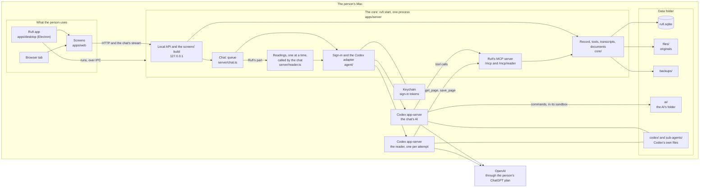
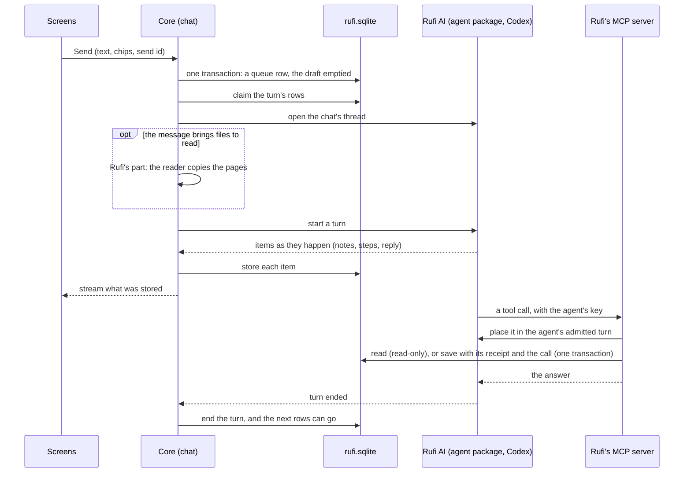

# How Rufi works

For developers: the main parts of Rufi, where its data lives and how it moves. It stays high level; the code and its tests have the detail, and the ADRs in [`adr/`](adr/) say why. The rules for working in the code are in [`AGENTS.md`](../AGENTS.md); what people see and do is in the [help](help/index.md).

## The parts

Everything runs on the person's Mac. One process, the core (`rufi start`), owns the data folder; the screens, the Rufi app and the AI reach the record only through it.

| Part                                    | What it does                                                                                                                                             | Borders                                                                                                                                   |
| --------------------------------------- | -------------------------------------------------------------------------------------------------------------------------------------------------------- | ----------------------------------------------------------------------------------------------------------------------------------------- |
| **Screens** (`apps/web`)                | React pages: the record, the chat, documents, Settings, Help.                                                                                            | Read the record only through GET routes; every change starts in the chat. Use only `@rufi/contracts`, `@rufi/brand` and the HTTP API.     |
| **Rufi app** (`apps/desktop`)           | An Electron window on the same screens, with notices on the Mac.                                                                                         | Runs `rufi start` as a child and talks to it over Node's IPC channel; imports no server or screen code.                                   |
| **The core** (`apps/server`)            | The one process that holds the data folder's lock, owns the database, runs each chat and the readings, and serves the local API on the loopback address. | Folders in `src` have borders that lint checks: `platform` → `core` and `agent` → `server` → `cli`.                                       |
| **Codex app-server**                    | The AI's agent, pinned. One for the chat; one of its own for each reading attempt.                                                                       | Gets Rufi's tools only from Rufi's MCP server. None of the person's own Codex setup is loaded.                                            |
| **Rufi's MCP server** (`server/mcp.ts`) | Rufi's tools for the AI: `/mcp` for the chat, `/mcp/reader` for the reader.                                                                              | On the loopback address, with a key for each agent or reading attempt. Rufi decides the person and what a call may do, never the request. |
| **Data folder**                         | The record, the originals, the backups, Codex's files and the AI's folder.                                                                               | Only the core writes the database.                                                                                                        |

ADRs: [0001](adr/0001-codex-on-chatgpt-plan.md) (Codex on the ChatGPT plan), [0002](adr/0002-effect-runtime.md) (Effect), [0003](adr/0003-node-sqlite.md) (SQLite), [0016](adr/0016-rufis-tools-over-mcp.md) (tools over MCP).

## Where the data lives

One data folder holds everything (default `~/.rufi/data`). The core finds it once, at start: a non-blank `RUFI_HOME`, else the folder that `~/.rufi/location.json` names, else the default, made at the first start. It never makes an empty record in place of a remembered folder that is gone, and it refuses a folder that a move or a restore left half done; a first start that stopped goes on at the next start. See [ADR 0014](adr/0014-where-rufi-keeps-its-data.md).

| In the data folder                                   | What it is                                                                                                                  |
| ---------------------------------------------------- | --------------------------------------------------------------------------------------------------------------------------- |
| `rufi.sqlite`                                        | The record, each chat's transcript and queue, the reader's page copies (and older notebooks), draft items, settings         |
| `agents.sqlite`                                      | The agent system's own database (below); not backed up, exported or moved                                                   |
| `files/`                                             | Each document's original, named by the SHA-256 of its content                                                               |
| `cache/`                                             | Copies made again when missing: HEIC photos as JPEG, PDF pages drawn for the AI                                             |
| `backups/`                                           | Checked backups; `backups/before-upgrade/` is never pruned                                                                  |
| `chatgpt.json`                                       | Who signed in, without secrets (the tokens are in the Keychain)                                                             |
| `logs/`                                              | `rufi.log`: fixed events and checked fields only                                                                            |
| `codex/`                                             | The chat's Codex home: its settings, Rufi's skills (written at each start), its own copy of each thread, generated pictures |
| `sub-agents/`                                        | The reader's Codex home and an empty working folder; no document                                                            |
| `ai/`                                                | The AI's folder: the only place the chat AI's commands can write                                                            |
| `core.json`                                          | While the core runs: how `pnpm start` and the app find it                                                                   |
| `codex-door/`                                        | While a Codex runs: its token door's address and key (`chat.json`, `reader.json`), which the AI can't read                  |
| `rufi.lock`, `credentials.lock`                      | Folders held while a process uses the data folder, and while the sign-in changes (always `rufi.lock` first)                 |
| `installed.json`, `creating.json`                    | A record was made here; a first start that hasn't finished                                                                  |
| `restoring/`                                         | A restore that didn't finish                                                                                                |
| `moved-to.json`, `moving-out.json`, `moving-in.json` | A move's state in the old and the new folder                                                                                |

The core refuses to start on a folder with `installed.json` and no `rufi.sqlite`, with `restoring/`, or with any of the move marks.

## A message to the AI and back

- **Rufi AI on the agent package.** The chat's AI is the chat's own agent, Rufi AI, run by the agent package (`server/rufi-ai.ts`, below). The chat puts its waiting rows into Rufi AI's queue in the package by their ids, without their words, in Rufi's order, and the package hands them over: just before one goes, the package claims it from Rufi's queue, which gives its words as they are then. A message the person sends while a reply they started runs is a row like any other, saved before anything goes; the chat puts it in as a steer, and the package claims it the same way. Each event of the conversation reaches the chat as it comes and is stored or shown as below, for showing; the agent database's events are the record. From them, with Rufi's cursor in the same transaction, a turn's start the chat didn't store becomes its reply, running, with the rows it took sent; what became of each other row the package handed over is applied (delivered: sent; back in line: waiting; held, with its line; not sure; dropped by a Stop: held as not sent); a completed turn's whole answer goes on the reply row it streamed as (or a row of its own when nothing streamed), also when the chat stored the turn's end itself, unless Rufi ended the turn on its own (Stop, a failed save); and a turn's end the chat didn't store (a write failed, or Rufi closed meanwhile) ends the reply so. A steer the provider confirms after its turn ended is saved under that turn.
- **Rufi owns the queue.** What waits to go to the AI (the person's messages, and notes from Rufi's events) is in Rufi's database, one queue per chat; Rufi AI's queue in the package has their ids, never their words. A send moves the box's text into a row and empties the draft in one transaction, keyed by the send's id, so a resend after a lost answer is not taken twice. See [ADR 0004](adr/0004-conversations-are-rufis.md).
- **Files go with the message.** A file the person chooses is stored at once but unsent (`documents.sent_at` is null): it is a chip in the box and is left out of every list, count and tool until a send sets `sent_at` in the send's transaction. A chip taken out removes an unsent file. See [ADR 0022](adr/0022-files-start-on-send.md).
- **Rufi's part.** A message whose chips need reading waits in Rufi, with the rows behind it, until it is next and Rufi AI is idle. Then, in the chat's lane, Rufi marks it handing over (no `sent_as` yet), starts the reply (its turn has no agent turn yet) and makes the reading jobs in one transaction. Outside the lane, so Stop and other short actions still work, it calls the reader for each job in turn; each is a `reading` activity of the reply with its progress. Then Rufi keeps its note on what was copied, built from the stored page states, with the message (`chat_queue.note`), and the message goes to Rufi AI's queue first in line: every claim of it gives the note too, also after a crash. The rows behind it follow. If the reading doesn't finish (Stop, an account problem, the deadline, a restart), the reply ends there, every job it made that hasn't finished fails with its copies kept, and the message waits with the hold `reply_ended` and a **Retry**; the rows behind it go on. If the hand-over after the reading fails, the reply ends the same way. An empty `sent_as` means the AI surely never got the message, so Retry is safe; a set one keeps the "not sure" rule. Nothing is read by itself after a restart.
- **One turn at a time, in order.** Rufi AI's queue in the package starts a turn only when none runs, and Rufi claims each row in its database before the AI gets it. A row Rufi isn't sure reached the AI becomes "not sure" and is never sent again by itself; the rows after it go on. Stop ends the reply only: what waits goes next. A start that Stop cut off doesn't go: its row waits held as "Not sent: stopped." Edits change Rufi's row only (the claim takes its words as they are then); removals, a new order and send now change Rufi's rows first, then Rufi AI's queue by the same ids. Signed out, nothing goes in, and a row the AI found signed out waits held until a later hand-over is signed in.
- **Chips are pointers.** The core checks each chip against the person and stamps its version when it accepts the message; the AI is told exactly which records, at that version.
- **Stored first, shown from what was stored.** The person's messages, the AI's answers (with the questions it asks kept apart from the answer's text), receipts and events are written to the transcript, then streamed to the screens. Rufi AI's steps, notes and reasoning are kept by the agent database (below): a page reads them from there, each after what its reply started with, in the order the reply reported them, and the stream shows them as they come. A note's or a summary's text is stored once whole, or as far as it came when its reply ends; until then the package gives it from what it holds, so a page read meanwhile has it too. A reply from before keeps its lines in the transcript. The screens read older entries by pages of whole turns; a reconnect starts again from the latest page. Lines such as the day lines are worked out when shown, never stored.
- **Rufi's events.** Something outside the chat (a document deleted) is one transaction: a transcript line and, when the AI should know, a queue row with origin Rufi. A turn started only by Rufi's notes can read but not save or sort (the tool caller refuses both). A reading is not an event: it is a step of the person's own reply.
- **The reply's basis.** The AI writes where its answer comes from at the end of the reply; Rufi stores the reply as it came and splits the basis off when it reads it. See [ADR 0007](adr/0007-the-basis-travels-inside-the-reply.md).

## Rufi's tools and the record

The AI reads and changes the record only through Rufi's tools (`core/tools/`, listed in `apps/server/tools.json`): read the Overview, records, documents and earlier chat; save changes; set draft items aside; make a visit brief. Reading is not one of them: the person's **Retry** puts the document in the chat.

- **One person.** Rufi chooses the person whose chat it is. No tool takes a person, a table or SQL from the AI. See [ADR 0006](adr/0006-the-ai-reads-one-persons-record.md).
- **Reads are read-only and bounded.** Tools read through their own read-only connection. One `get_records` answer holds at most 200 records and 32 KB (a single larger record comes back on its own); when there are more, it says where it stopped and the AI reads on. A failed read is an error, never an empty list.
- **A save is all or nothing, with a trace.** `save_changes` writes, in the chat only, in one transaction: the records, each one's before and after, its sources (the person's message, a document page or a Visit), and an operation whose order is the order of saves. The receipt the person sees is built from what was stored, not from the AI's words. Records are never deleted, only marked removed. See [ADR 0005](adr/0005-the-record-changes-by-chat.md) and [ADR 0011](adr/0011-the-record-upgrades-by-migrations-and-keeps-the-order-of-saves.md).
- **The record's kinds.** Medicine uses, Visits, symptoms, conditions, allergies, results, care events (procedures and immunisations), "none known" statements and follow-ups, one table each, listed once in `core/record/kinds.ts`. A Visit keeps the doctor's words as written; the records saved from it cite it in `record_sources`, many to many. A change names the pages and Visits it rests on in `from`; `action: "link"` adds sources and changes no value; `ref` names a record a save adds, so the Visit and the records from it go in one save. See [ADR 0021](adr/0021-a-visit-keeps-the-doctors-words-and-records-saved-from-it-cite-it.md).
- **Code checks the shape, the AI judges the meaning.** Code checks a date's calendar shape, that a source is the person's message in this chat, and the health rules. Whether the person said yes, and what they meant, is the AI's judgement, written in its instructions and skills.
- **Refusals end a reply.** A reply ends after three refused tool calls (the setting `rejections_per_reply`).

## The AI's instructions and its folder

- **Instructions.** A short core in the thread's developer instructions (`core/chat/instructions.ts`: what every reply needs, the safety rules, the skills' index and the tool names) and one skill per job (`core/skills/<name>/SKILL.md`), written into Codex's home at each start. A skill can carry files beside its SKILL.md, such as the analysis skill's `paper.css` from `packages/brand`: they are written with it into `codex/skills/<name>/`, replaced at each start (never in `ai/`), and offered over Rufi's MCP server as `skill://<name>/<file>`. Codex's bundled skills are off. The rules version is a hash of the core and every skill with its files.
- **The AI's folder.** The chat's AI works like a coding agent in `ai/`, under Rufi's permission profile `rufi-ai`: it writes only there and in the temp folders, can use the network, and can't read the two databases and their files, `backups/`, `core.json` (its temp copy too) or `codex-door/`. Its commands get no variable named like a secret. So the record is reached only through Rufi's tools. See [ADR 0016](adr/0016-rufis-tools-over-mcp.md).
- **What a reply shows.** The AI's text is Markdown only. A picture or a page the AI made is served from the AI's folder (or Codex's generated pictures) by a short-lived address for one file; a page runs in a locked frame with no network and no way to reach Rufi. See [ADR 0017](adr/0017-a-reply-shows-the-files-the-ai-made.md).

## The AI's memory of the chat

Each person has one chat, and each chat's Rufi AI has one conversation, a Codex thread: the chat's thread is that conversation. The transcript in `rufi.sqlite` is Rufi's own copy of the chat; Codex keeps its own copy of the thread in `codex/`. See [ADR 0018](adr/0018-the-ai-keeps-its-thread.md).

- **The same thread goes on.** A restart of Rufi, a new model or a new effort resumes the same thread; the model and effort go with the next turn.
- **Compaction is Codex's.** When the thread's context gets near full, Codex compacts it in the same thread; Rufi never asks for one. Rufi stores the compaction's start and end as activity, and the chat works out its lines from them when it shows them: "Compacting chat history…" while one runs, "Chat history compacted" once it completed, nothing for one that a Stop or a crash cut off.
- **The context meter.** The chat stores the last token usage Codex reported, also outside a reply (a resume replays it), as it came: the last request's tokens, the model's context window, and the thread they belong to. The screens show tokens over window as a percentage, only while that thread is the chat's and the window is known.
- **A new thread only when the thread is gone, or by choice.** Rufi starts a new thread when the chat has none (the first message, a move, the person's **New thread**), when the thread is another agent's, when Codex answers the resume with "no rollout found for thread id <id>" for that thread, or when a turn's start finds Codex no longer has it (the message then goes first, in the new one). When `agents.sqlite` is lost, the chat's new Rufi AI starts a new thread the same way. A new thread starts with the chat's last 10 entries that reached the AI (never a message still waiting) and a note that older ones can be read with `read_chat`; after an earlier thread, the chat shows "New thread started" at the new one's first turn.
- **Any other failure to open the thread holds the message.** The hold is its own state (`open_failed`) with an id for that occurrence, and the message shows Codex's error. **Try again** and **New thread** name that hold; one transaction in the chat's lane checks it is still the current one and releases the message (New thread also clears the chat's thread), so a click on an older hold or in a second tab changes nothing. New thread is refused while a reply runs, and a message that is "not sure" never gets these choices.
- **New rules reach the same thread.** When the rules version changes (a Rufi update, another emergency region), Rufi has the package let the conversation go, and Codex resumes it with the new core and the complete new rules added to its history as one developer message with `thread/inject_items`. Codex's adapter adds that message at every resume, also when Rufi starts again with the same rules. The version is stored only after Codex acknowledged it, so a Stop or a crash before then gives the rules again with the next hand-over.

## The agent system, being built

`packages/agents` (`@rufi/agents`) will run every agent: Rufi AI's chat and the sub-agents it starts, on Codex or Claude. Rufi starts it beside the record with the Codex adapter, and Rufi AI's replies run through it (above), as do the sub-agents Rufi AI starts (below).

- **The provider boundary** (`src/provider.ts`) is what every provider's adapter does, so nothing above it names a provider: say its family and list its models with their efforts; open or resume a conversation, given its folder and, each time, Rufi's instructions and tools; start a turn and steer it, each answering delivered, not delivered or uncertain from what the provider showed (a steer may also have started the next turn); stop a turn within a bound, settling the steers still handing over for it; reconcile which inputs arrived; delete a conversation; place each call to Rufi's tools in its open turn, with the provider's call id; and report the turn's events as the provider gave them. An input that may have arrived is never sent again by itself.
- **Codex behind the boundary** (`agent/codex/adapter.ts`): the agent system's conversations are Codex threads on one shared app-server. A start or steer Codex answered no is not delivered, and a start that found the thread gone says so (missing); one whose answer was lost is uncertain, and the thread's turns say later whether it arrived (one it doesn't list stays unknown, as Codex may still act on it). A new thread's start and its first input share one decision on the sign-in, as Codex has nothing of the thread to resume until that input. A resumed thread is given its instructions again as a developer message saying they replace the earlier ones, since Codex's history keeps the first ones. A call is placed by the thread, turn and call ids in its `_meta`. A turn has no time limit, and Codex renews its token through Rufi's token door as it goes ([ADR 0024](adr/0024-codex-gets-its-token-from-rufis-token-door.md)).
- **One contract suite** (`tests/contract.ts`) checks this for every adapter, on its own fixtures. A fake provider (`tests/fake-provider.ts`) keeps the same contract and stands in for adapters in the package's own tests.
- **The agent database** (`src/store.ts`, `agents.sqlite` in the data folder) is the package's own file: agents, their turns and steps, the questions each turn asked (apart from the step or answer they came with, so a question never changes it), one queue for every agent's inputs, the agent tools' receipts, and an event log. Every change writes its event in the same transaction, and the file is written only inside a change, so nothing a change started writes after it; the file's random generation id and each event's number tell Rufi where it is in the log, and a new file (the old one lost) has a new generation. It isn't backed up, exported or moved; losing it loses steps and sub-agents, never a message or an answer, which are Rufi's. See [ADR 0024](adr/0024-the-agent-system-keeps-its-own-database.md).
- **Running agents** (`src/agents.ts`). An agent is made not admitted, and runs only once Rufi has saved who owns it and admits it. Its conversation opens at its first turn: resumed by its reference, or, when the provider no longer has it, a new one under the next number, with a seed from Rufi. A new conversation's reference goes to Rufi's ledger before anything of Rufi's goes into it. Each turn is admitted when the provider says it started, with the inputs it took, also a turn the provider began by itself with a steer it was handed; what the turn reports is kept as steps, and its end becomes the agent's status and latest result. A call to Rufi's tools is placed only in an admitted turn that is still open, in a conversation still open here: Stop closes the turn to new calls before the provider has stopped it, and a start that Stop reaches while it is still opening never goes to the provider (its input is dropped, and what waits behind it goes on). Stop also has the provider settle the steers it still holds, even after their turn has ended. A turn begun before that Stop has finished, also when the stopped turn ended during it, is closed from its admission and stopped too. A child's tools are among its parent's. Forgetting agents removes them, everything below them and all they kept, then lets go of their conversations, each one even when another fails; forgetting again tries those that failed.
- **One queue for every agent.** Every input waits in the agent database's `queue`, whoever sent it, and one dispatcher for each agent hands them over in order, with no priority: the first waiting input starts a turn; a steer goes into the running turn at once (one sent while a turn starts goes in the moment it is admitted); a queued input waits for the turn to end. An input whose words Rufi keeps (the person's messages, Rufi's notes) is claimed from Rufi first: one Rufi transaction marks it handing over to that agent's conversation and gives back its words; a repeat of the same hand-over (the package stopped after Rufi's claim) gets the same words, and only a message removed or sent meanwhile is dropped. The hand-over is saved before the provider call. What became of an input rests on what the provider showed: a steer it didn't take goes back first in line and starts the next turn; one whose answer was lost is reconciled, and becomes _not sure_ (never sent again by itself) when the provider can't tell; while one is still with the provider, even after its turn ended, nothing else starts, and a Stop then asks the provider to settle it (one it cancelled goes first in line). Nothing is handed over while a Stop is under way; what waits goes on once it has finished. Nothing is handed over until Rufi has finished starting and dispatches, once; inputs a crash left with a provider are asked about first. Signed out, a conversation that didn't open, or a refused start holds the input with its line; the hold lifts on sign-in or when Rufi releases it. The sender is never told no.
- **What the host sees and asks.** The package shows the host each event of an agent's open conversation as it comes, once it has kept what it keeps of it, for showing only. In the package's own events, a delivered input names its turn by the provider's reference too, and a whole answer names the item it streamed as. The host can open an agent's conversation now, have it opened again while it is idle (with what the host gives then, or as a new one), and set the model and effort of its next turns. A start that finds the conversation gone (missing) lets it go, and the input goes first in a new one.
- **One door for every agent** (`server/door.ts`). Each agent has its own key to Rufi's MCP server for the run, given with its conversation each time it opens, and sees only its own tools. The door hands a call's `_meta` to the package, whose adapter places the call in an open turn of that agent's conversation; the package gives it only once that turn is admitted, waiting for one the provider began by itself until the call's deadline. Anything else is refused, reading tools too. Rufi's id for the call is `<agent>/<conversation>/<provider call id>` (`callIdOf`), so a repeat makes one save and one receipt (its answer may differ from the first) and no two agents share one. One caller, built from the placed scope, runs every tool (`rufiCaller`, `core/tools/tools.ts`); a write, its receipt and the call with the AI's exact answer commit in one transaction. See [ADR 0016](adr/0016-rufis-tools-over-mcp.md).
- **Sub-agents** (`core/tools/agents.ts`, `server/sub-agents.ts`). An agent of the chat starts one of its own with `start_agent`: a title and its whole task. It is the one kind: Codex's own sub-agents are off in the chat's Codex. Its id is the call's Rufi id, so the call again finds it; it is made, its task queued, its owner kept (the chat's, not its root), then admitted, each step only if it isn't done. It runs on its parent's provider, model and effort, in the same folder, with its parent's tools or fewer (a wider list is refused and nothing starts), and goes on after the reply ends. Its conversation opens with Rufi AI's instructions and a part of its own naming the agent that started it, and with its task alone, never the chat; its events don't reach the chat. Its calls go through the same door and caller, as the chat's, so a save shows with its receipt, which names the sub-agent by its title, and belongs to no reply; a brief's line names it too. `agent_status` gives each agent below the caller with its status and latest result, without waiting; `read_agent` gives a page of 10 turns of the caller's own conversation or one below it, each with its inputs (who sent it and its words, Rufi's from `chat_queue`), its steps and its result. Anything else is not found. See [ADR 0025](adr/0025-agents-start-sub-agents.md).
- **Rufi and the package keep in step** (`server/agents.ts`, `core/chat/agents.ts`). Rufi keeps whose each agent is (`agent_owners`, a chat's own agent marked as its root), every provider conversation a chat's agents have had (`agent_conversations`, the ledger, kept when the agent database is lost), and how far it has read the agent database's events (`agent_cursor`: the database's generation and the last event read; what Rufi applies of an event, a root turn's start or end, commits with the cursor). At each start, before anything goes to a provider: an agent database Rufi hasn't read ends Rufi's links to the old one's agents (never the ledger), and a message Rufi had claimed and marked for it is _not sure_; an older copy of one Rufi has read (its events end before Rufi's cursor, counting forgotten ones) is renewed with a new generation and read the same way, as its waiting inputs may have gone already; an agent nobody owns, admitted or not, is forgotten with everything below it and its waiting inputs, an owner whose agent is gone is removed, and an owned agent not yet admitted is admitted, and each chat's own agent gets Rufi's tools as they are now; each chat without its own agent gets one, Rufi AI, which takes over the chat's thread unless an agent had it before; Rufi reads every event it hasn't, then each one as it commits, and only then ends the replies still running as cut by Rufi closing; and a message Rufi claimed that the package never saved is asked about by the conversation it went to: one the provider didn't get waits again in its place, any other is _not sure_. The package hands nothing over until Rufi's own recovery has run, Rufi's MCP server listens and each chat's waiting rows are in Rufi AI's queue, and Rufi dispatches. A claimed row the package never saved, under a conversation Rufi doesn't own, is _not sure_.

## The reader

Rufi reads each document when the person sends it, with its own sub-agent, one document at a time across Rufi. The chat calls it for one job and an abort signal (`server/reader.ts`); there is no loop and no queue of work waiting in the background. See [ADR 0009](adr/0009-background-readings-by-a-rufi-sub-agent.md), [ADR 0010](adr/0010-the-reader-runs-on-gpt-6-1-sol-through-exec.md) and [ADR 0022](adr/0022-files-start-on-send.md).

- **Locked down.** Each attempt runs in a Codex app-server of its own, in an ephemeral thread, with no shell, files, network, web search, sub-agents or skills, and exactly two tools from `/mcp/reader`: look at a page (`get_page`) and save its copy (`save_page`). On GPT-6.1-Sol it calls them through code inside Codex's `exec`; on GPT-5.5 directly. The runner refuses other models, and fails a turn that shows anything it didn't allow.
- **Pages.** One page service serves the reader and the chat's `get_documents`: a PDF page drawn as an image, with its own text when it has some; a photo as added, a HEIC as its JPEG copy. Images go to the AI and are never stored in the transcript.
- **It copies, and decides nothing.** The reader copies each page as Markdown (HTML for a table Markdown can't hold), exactly as printed, and marks what is unclear; it gets the file's name and pages, never whose document it is. Its page copies are kept in `page_copies`, one for each page of a file and reading (known by the file, the page in the file and the reading, never by the document the page is in); a reading's runs replace a page's copy until it ends, so a compaction, a stop or a restart loses nothing. A page's current copy is the one from its latest finished reading. Pages an older reader saved as notebook entries keep them, and are shown as they are.
- **A job lives inside a reply.** Jobs (`jobs`) are made when a reply starts, for the message's documents that need reading, and failed when Rufi's part ends without finishing them or at the next start, so `queued` and `running` exist only inside a live reply. One slot guards the runner, so readings stay one at a time across people. A finished reading is one transaction: the page states and the document's version. It writes no chat line and asks for nothing; the chat hands the message to Rufi AI.
- **Retries.** A passing failure is tried again by itself after 30 seconds, 1 minute and 2 minutes, inside the reply. An account problem (signed out, a usage limit), Rufi's deadline (5 minutes plus one a page, at most an hour) or a fourth failure ends the reading as failed, with the copies kept: the reply's **Retry** goes on from the next page not copied.
- **Measured.** The reader pack (`scripts/reader-pack.ts`) reads the copy set (`tests/pack/copy-set.ts`) with the real reader: an AI judge (one sub-agent turn for each copied page, on the test sign-in) gives each row of the page's hand-checked key a verdict (same, changed and marked, changed silently, missing or unsure), and code counts only the facts (pages copied, rows on pages with no copy) and the verdicts. `pnpm smoke --only sorts_the_copy_set` sends the same set in a message, so it is read and sorted live.

## Sorting

Rufi AI, the chat's AI, decides what the reader's copies are: it splits an add (the document as the person added it) into documents and writes their draft items. See [ADR 0019](adr/0019-rufi-ai-sorts-and-drafts.md).

- **In the person's reply.** Rufi starts no reply of its own to sort. When the reader has copied the pages, the message and a note of what was copied go to the AI in the same reply. The `sorting-documents` skill says: when a message brings documents that aren't sorted, sort them first, one `sort_documents` call for each add, then answer what the user wrote, or tell them what you found when they wrote nothing. A file the AI asked about, or whose part of the reply failed, stays "Not sorted yet" until a message sends it again; nothing is sorted or retried by itself.
- **One call, all or nothing.** The AI reads the copies with `get_documents` (`copies: true`) and makes one `sort_documents` call: the documents of the add, each naming the add's document it is by id (or none, for a new one), with its pages, and its kind, date, lab and report number (a named document keeps those left out), and the drafts, each on its page with the words it came from and, when it is worth a look, why. In one transaction, the chat's, which keeps the call's `tool_calls` row too (foreign keys checked at its end, so pages and their drafts move together), Rufi updates the named documents, makes the new ones (`documents.from_document` is the add, and they take the add's `sent_at`), moves pages, replaces the untouched drafts of the pages named, moves fixed and set-aside drafts with their page, tombstones a document left with no pages, and marks the readings sorted (`jobs.sorted_at`). The same call again gets its stored answer back. It refuses, with every problem and nothing written, a call that leaves a page not sorted, names a page or a document twice, names a document not of the add, leaves the add's own document out while moving all its pages, moves a page a saved result cites, or has a draft on a page with no copy; and it refuses a sort while a reading of the add is queued or running. What a draft says is Rufi AI's reading of the page: code doesn't compare it to the copy. A reply Rufi started (a note about a deleted document) can't sort, as it can't save; a person's reply may sort any of their adds again.
- **Saving.** A draft saves into its document's report (its lab, report number and date), with its own date, its values taken from the stored draft. A value the person fixed on the document's page is kept as typed, with no number (the page parses nothing); the AI gives its number in `save_changes` (`value_number`, `comparator` on the item), and code takes one only for such an item. A draft from before sorting saves the same way. A draft whose page was read again since it was drafted is out of date: not counted, and refused.

## Device data

What a person's devices measure comes in without a chat and stays outside the record. See [ADR 0023](adr/0023-device-data-comes-in-without-a-chat-and-stays-outside-the-record.md).

- **Three tables.** `device_sources` binds a connection to one person for good (`pnpm rufi device-source add`); `device_batches` keeps each batch exactly as it came (gzip) with its state (`waiting`, `done`, `failed`); `device_values` keeps each value in Rufi's terms, keyed by the source system's own ID.
- **Store first.** Receive (`core/devices/devices.ts`) checks the source, the size, JSON and the envelope, and stores the batch `waiting` with the next `seq`, in one transaction. Today only `pnpm rufi device-import` sends batches, with Rufi closed; the phone comes later.
- **The converter.** `server/converter.ts` converts the due batches one at a time, each in one transaction, in `seq` order within each person's batches from one system. Each item converts or is skipped with a fixed reason (`core/devices/convert.ts`); only an outside cause fails a batch, which then holds back its group and is retried after 30 seconds, 1 minute, 2 minutes, then hourly and at each start. If even the failure can't be written, the converter keeps its reason in memory for Settings.
- **The type list.** `core/devices/types.ts`: each type's key, label, UCUM unit, LOINC code, Apple identifier, accepted units and metadata kept. A shipped key never changes.
- **Clean-up.** In the converter's loop, at start and daily, and at once after a shorter **Keep values** (the setting saves at once; Settings shows the clean-up running): values older than the kept time go, 5,000 a transaction, each working out its cutoff in its own transaction, with saves and the screens answered between chunks; a converted batch goes 30 days after it was converted (values' links to it are emptied first), unless it has skipped items.

## Documents' originals

An original is kept in `files/<sha256>` exactly as it came, written and synced before any row points to it; then one transaction writes the document and its pages. The same content belongs to at most one live document per person. Files are inspected (type by content, page count, a HEIC's copy) in a worker thread with a deadline. A deleted document becomes a tombstone: its row and its pages' names stay, its file goes when no other person's document needs it. A file gate makes sure that a backup or the export never copies a file while a delete removes it. See [ADR 0015](adr/0015-deleting-a-document.md).

## Backups, upgrades, moves and the export

- **Backups.** The core makes one as it starts (in the background) and then once a day, and looks every hour, so a Mac that slept catches up. A backup is one fixed copy of the database (SQLite's online copy) and every original it names, each checked by its hash; it counts only after its check. Originals are cloned where the disk allows. Rufi keeps the newest backup of each of the last 7 days and 4 weeks, and prunes only after a new backup passed its check. Never in a backup: the sign-in, Codex's files, the AI's folder, caches, logs. See [ADR 0008](adr/0008-a-backup-holds-the-record-and-its-originals.md).
- **Upgrades.** A schema change is a migration. At start, under `rufi.lock`, the core refuses a newer or unknown record unchanged, backs up an older one into `backups/before-upgrade/` (a failed backup stops the start), then runs every pending migration in one transaction with integrity and foreign-key checks. See [ADR 0011](adr/0011-the-record-upgrades-by-migrations-and-keeps-the-order-of-saves.md).
- **Restore.** `pnpm rufi restore` copies a checked backup into a new or empty folder, never over anything, and upgrades only that copy. Codex's files aren't in it, so Codex finds no saved thread on the next resume, and the chat starts a new one. Messages that waited when the backup was made come back held.
- **Move.** `pnpm rufi move-data` copies the data folder into a new or empty one while Rufi doesn't run, checks the copy, then switches the location file. Codex's files and the AI's folder stay behind because they name the old folder; the move clears each chat's thread, so the next turn starts a new one. See [ADR 0014](adr/0014-where-rufi-keeps-its-data.md).
- **Export.** One zip from one fixed copy of the database: each table as JSON and CSV (a byte value, a device batch as it came, as base64), Rufi's device type list as `device_types`, every original named by its hash, and a README. Streamed: each table is read row by row (`StatementSync.iterate()`) into its zip entry (`fflate`'s streaming `Zip`), each chunk written to a file in the export's staging folder before the next is read; the originals are read inside the file gate. It is written through Node's write stream, which finishes short writes, and the writer counts and hashes every byte, the zip's directory and end record too. Then it is checked by reading the zip back in chunks: every byte must be the bytes written, and every entry but the originals (checked against their hashes as they were written) is compared, with `Unzip`, against a second pass over the copy, each row read back as its values. It is sent from its file. If the person goes while it is made, it stops; the staging folder goes on every way out, and once sent, when the answer ends or is cut.

## Sign-in

The person signs in with ChatGPT in the browser; the tokens go to the Keychain, never to files or logs. A data folder belongs to the first account that signs in with it. Renewal and sign-in changes take `credentials.lock` inside `rufi.lock`. Codex never gets the sign-in itself: it receives access tokens through Rufi's token door as it works, a fresh one when it asks, and keeps none in its arguments, environment or settings, which any program of the user's can read. See [ADR 0001](adr/0001-codex-on-chatgpt-plan.md) and [ADR 0024](adr/0024-codex-gets-its-token-from-rufis-token-door.md).

## Follow-up notices

Due and overdue are worked out from the follow-up's date, at the precision the person gave it. The Rufi app asks the core for due notices as it starts, every 15 minutes and when the Mac wakes, and claims each one so it shows once. See [ADR 0012](adr/0012-follow-up-notices-are-claimed-through-the-app-channel.md).

## Logs

`logs/rufi.log` holds fixed events with checked fields only (`platform/logs.ts`): names, statuses, error codes, timings. Never prompts, replies, health text, tokens or error messages. A new file starts at 10 MB, and Rufi keeps five files. `pnpm rufi ask --debug` shows the same lines.
